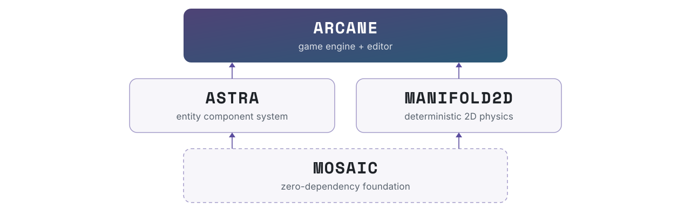

<a href="https://starworks.dev">
  <picture>
    <source media="(prefers-color-scheme: dark)" srcset="assets/hero-dark.svg">
    <source media="(prefers-color-scheme: light)" srcset="assets/hero-light.svg">
    
  </picture>
</a>

[Website](https://starworks.dev) · [Arcane](https://starworks.dev/arcane) · [Astra](https://starworks.dev/astra) · [Manifold2D](https://starworks.dev/manifold)

We make games, and we build the technology under them in the open. Every layer of our stack is a library you can take on its own: an ECS, a 2D physics engine, a shared foundation, and the engine that ties them together.

| Project | What it is | Language | License | Build |
|---|---|---|---|---|
| [**Arcane**](https://github.com/StarworksDev/Arcane) | Game engine + editor | C++23 | BSL 1.1 → MIT |  |
| [**Astra**](https://github.com/StarworksDev/Astra) | Entity Component System | C++20 | MIT |  |
| [**Manifold2D**](https://github.com/StarworksDev/Manifold2D) | Deterministic 2D physics | C++23 | MIT |  |
| [**Mosaic**](https://github.com/StarworksDev/Mosaic) | Zero-dependency foundation | C++23 | MIT |  |
| [**hero3d**](https://github.com/StarworksDev/hero3d) | Text + UI on planes in perspective | TypeScript | MIT | `npm i @starworks-dev/hero3d` |

## The stack

<picture>
  <source media="(prefers-color-scheme: dark)" srcset="assets/stack-dark.svg">
  <source media="(prefers-color-scheme: light)" srcset="assets/stack-light.svg">
  
</picture>

## Projects

### [Arcane](https://github.com/StarworksDev/Arcane) &nbsp;·&nbsp; game engine
A C++23 game engine and editor. Your game is a hot-reloaded shared library, hosted by the editor, a standalone runtime, or a dedicated server. Rendering goes through NRI on **D3D12 and Vulkan** (MoltenVK on macOS). Gameplay code uses a flat `Arcane::` API over Astra and Manifold2D, and the editor runs on the same renderer as the game.
Developed on Windows; builds and runs its test suite on Windows, Linux and macOS in CI.

### [Astra](https://github.com/StarworksDev/Astra) &nbsp;·&nbsp; ECS
An Entity Component System reimagined for modern CPU architectures and cache hierarchies: archetype storage in contiguous 16 KB chunks, SIMD-accelerated paths (SSE2 / SSE4.2 / AVX2 / NEON), relationship graphs, and compile-time optimized queries.

### [Manifold2D](https://github.com/StarworksDev/Manifold2D) &nbsp;·&nbsp; 2D physics
A deterministic 2D physics engine modeled on Box2D v3's algorithms: a graph-colored soft-step solver with persistent islands, a dynamic-tree and spatial-grid broadphase, GJK / EPA / MPR and SAT narrowphase, continuous collision, and an exact-predicate geometry kernel. Standard library only, with no other dependencies.

### [Mosaic](https://github.com/StarworksDev/Mosaic) &nbsp;·&nbsp; foundation
The shared ground every Starworks library is built on: platform and SIMD detection, deterministic lane-wide math, and pluggable seams for jobs, logging and asserts. Standard library only. It never creates its own threads; the host injects a scheduler.

### [hero3d](https://github.com/StarworksDev/hero3d) &nbsp;·&nbsp; web
Readable text and real, clickable UI on planes in perspective. It uses Canvas 2D, has no dependencies, and a typical hero is about 3 KB gzipped. It draws the hero scenes on our website.
`npm i @starworks-dev/hero3d`

## Licensing

| | License |
|---|---|
| Astra, Manifold2D, Mosaic, hero3d | MIT |
| Arcane | [Business Source License 1.1](https://github.com/StarworksDev/Arcane/blob/main/LICENSE): free to use and to ship games with, provided your game's credits say *"Made with the Arcane Engine"*. It may not be used to offer a competing engine product. Each version becomes MIT four years after its release. |

Made by Starworks · <a href="https://starworks.dev">starworks.dev</a>

